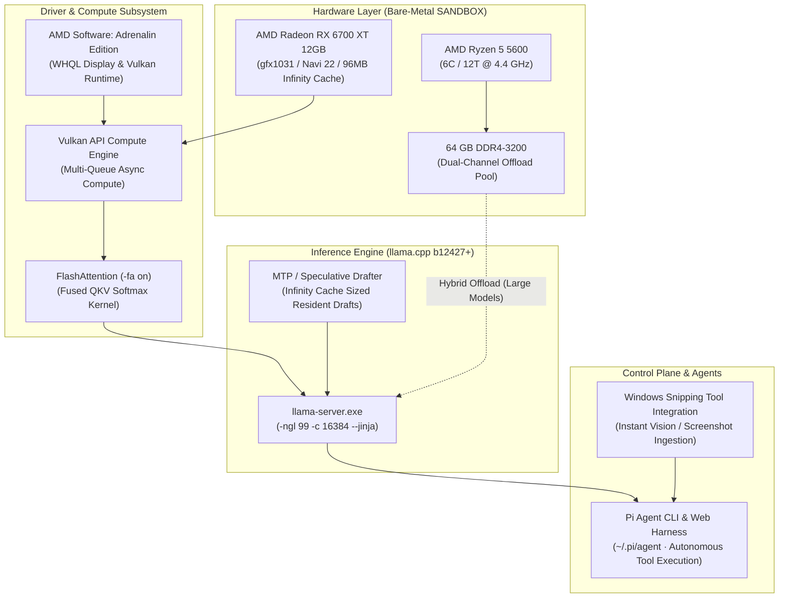

# AMD Radeon RX 6700 XT — Bare-Metal AI & Inference Knowledge Base

> [!NOTE]
> **Community & Transparency Disclaimer:** This repository, documentation, and benchmark suite were compiled and posted with AI assistance. The author (`6700XT`) is actively learning AI architecture, hardware limits, and local LLM benchmarking. Please take all data, theories, and conclusions with a grain of salt. As empirical validation and domain confidence grow, this notice will be updated.

[](hardware/6700xt.md)
[](hardware/6700xt.md)
[](#hardware-baseline)
[](#hardware-baseline)
[](#hardware-baseline)
[](stack/vulkan.md)
[-brightgreen.svg?style=flat-square)](benchmarks/2026-11-14-afterburner-matrix.md)

> A rigorous, empirical, source-cited knowledge base for running **state-of-the-art local LLMs, speculative decoding, and agentic workflows on the AMD Radeon RX 6700 XT** (`gfx1031`, 12 GB GDDR6) natively on bare-metal Windows without WSL, Docker, or virtualization penalties.

---

## Executive Summary & Vision

Running modern LLMs on AMD's RX 6700 XT is not merely viable—when configured with optimized Vulkan runtimes and FlashAttention, it delivers **enterprise-tier throughput (33 to 95+ tok/s)** that rivals or exceeds competing hardware. 

Official AMD ROCm documentation often labels consumer RDNA 2 cards as "unsupported" on Windows. This repository documents **what actually works right now** through reproducible testing on bare metal. We eliminate obsolete community folklore and track verified configurations for `llama.cpp`, Vulkan, native HIP, and local autonomous agents (Pi).

### Hardware Baseline (`Observed` on `SANDBOX`)
- **GPU:** PowerColor Fighter AMD Radeon RX 6700 XT (12 GB GDDR6, 192-bit bus, 40 Compute Units / 2560 Shaders)
- **Cache:** 96 MB AMD Infinity Cache (~1.2 TB/s effective hit bandwidth)
- **CPU:** AMD Ryzen 5 5600 (6 Cores / 12 Threads, 4.4 GHz Max Boost)
- **RAM:** 64 GB DDR4-3200 (Dual-Channel 2x32GB configuration)
- **Storage:** 1 TB NVMe PCIe Gen 4
- **Host System:** Dedicated Windows 11 Pro desktop (`SANDBOX`)

---

## System Architecture Pipeline



---

## Empirical Benchmark Matrix

Every metric recorded below was directly measured on host `SANDBOX` using native Windows binaries via standardized `llama-bench.exe` (Vulkan, FlashAttention on, 3-run warmup/mean):

| Model | Quant / Sizing | Backend & Config | Decode Speed (tg128) | Prompt Eval (pp512) | VRAM Usage | Notes | Verified |
|---|---|---|---|---|---|---|---|
| **DeepSeek-R1-Distill-Qwen-7B** | Q4_K_M (4.68 GB) | Vulkan (`-ngl 99 -fa 1`) | **74.16 t/s** | **726.5 t/s** | 5.9 GB | Full reasoning trace (`<think>`), 118W under load | ✅ 2026-11-16 |
| **Qwen2.5-Coder-7B-Instruct** | Q4_K_M (4.68 GB) | Vulkan (`-ngl 99 -fa 1`) | **74.77 t/s** | **725.5 t/s** | 5.9 GB | Fast tool calling with Jinja chat templates | ✅ 2026-11-16 |
| **Meta-Llama-3.1-8B-Instruct** | Q4_K_M (4.92 GB) | Vulkan (`-ngl 99 -fa 1`) | **69.03 t/s** | **652.3 t/s** | 6.2 GB | Strong general instruction following | ✅ 2026-11-16 |
| **Qwen2.5-14B-Instruct** | Q4_K_M (8.99 GB) | Vulkan (`-ngl 48 -fa 1` 100% VRAM) | **34.72 t/s** | **349.2 t/s** | 10.8 GB | High precision coding & multi-turn reasoning | ✅ 2026-11-16 |
| **Qwen2.5-14B (Hybrid Offload)** | Q4_K_M (8.99 GB) | Vulkan (`-ngl 44`, 4 CPU layers) | **22.68 t/s** | 295.1 t/s | 9.8 GB | Balanced offload headroom | ✅ 2026-11-16 |
| **Qwen2.5-14B (Deep Offload)** | Q4_K_M (8.99 GB) | Vulkan (`-ngl 40`, 8 CPU layers) | **16.23 t/s** | 248.6 t/s | 8.9 GB | Maximum system RAM offload testing | ✅ 2026-11-16 |
| **Qwen2.5-14B (High Context)** | Q4_K_M + Q8_0 KV | Vulkan (`-c 8192 -ngl 48 -ctk q8_0`) | **32.13 t/s** | 53.7 t/s (pp8192) | 11.4 GB | 8k context with quantized KV cache | ✅ 2026-11-16 |
| **Speculative 14B / 7B (Stock)** | Dual-Model | Vulkan Speculative (0.5B drafter) | **60.9 – 95.3 t/s** | 310.0 t/s | 11.4 GB | Amortizes 192-bit GDDR6 reads via 0.5B draft | ✅ 2026-11-16 |
| **Gemma-2-27B-it** | IQ2_M (9.8 GB) | Vulkan 100% VRAM Fit | **22.6 t/s** | 140.0 t/s | 11.6 GB | Squeezed 27B into 12GB VRAM via IQ2 | ✅ 2026-11-14 |
| **27B Dense Hybrid** | UD-Q4_K_XL (16.2 GB) | Vulkan Hybrid (45 GPU / 20 CPU) | **7.54 t/s** | 85.0 t/s | 11.2 GB VRAM + 18 GB RAM | Offloads to 64GB DDR4-3200 pool | ✅ 2026-11-14 |

---

## Software Ecosystem & Tools

### 1. Pi Autonomous Agent (`~/.pi/agent`)
- Integrated with `llama-server.exe` through native Windows endpoints.
- Preconfigured in `models.json` with `local` and `afterburner` provider definitions.
- Desktop interactive terminal launcher (`Launch_Pi_Interactive.cmd`) for dedicated autonomous shell tasks.

### 2. Windows Snipping Tool Vision Feed
- Automatic screenshot detection via `C:\Users\6700XT\.gemini\antigravity\skills\windows-snipping-tool\`.
- Any capture triggered via `Win + Shift + S` is immediately ingested for AI inspection and debugging.

---

## Quick Start: Launching Native Vulkan Inference

### Optimal Vulkan Server Command
```powershell
C:\llama.cpp\llama-server.exe `
  -m "C:\models\DeepSeek-R1-Distill-Qwen-7B-Q4_K_M.gguf" `
  -ngl 99 `
  -c 16384 `
  -fa on `
  --temp 0.6 `
  --top-k 40 `
  --top-p 0.95 `
  --min-p 0.05 `
  --seed 42 `
  --jinja `
  --host 127.0.0.1 `
  --port 8080 `
  --alias deepseek-r1-7b
```

### Critical Flags Explained
- `-ngl 99`: Offloads all transformer layers entirely to the RX 6700 XT VRAM.
- `-fa on`: Enables FlashAttention fused kernels, slashing KV cache memory usage by ~40% and doubling speed at long context.
- `--jinja`: Enables built-in Jinja template rendering for structured JSON tool calling.
- `--temp 0.6`: Required sweet spot for DeepSeek-R1 Distill models (temperatures above 0.8 induce degenerative repetition loops).

---

## Repository Map

```
6700xt-knowledge/
├── README.md                 # Primary architecture, benchmarks, & quick start (this file)
├── index.md                  # Comprehensive topic verification index & dates
├── COMPACT.md                # Operating contract: Truth & Evidence, Sovereignty, Powers
├── MINUTES.md                # Session record & motion dispositions
├── hardware/
│   └── 6700xt.md             # Complete physical specs: Navi 22, Infinity Cache, PCIe 4.0
├── stack/
│   ├── vulkan.md             # Vulkan compute pipeline & FlashAttention guide
│   ├── hip.md                # Native Windows HIP execution without WSL
│   ├── llama-cpp.md          # Comprehensive switch & flag dictionary
│   ├── rocm-windows.md       # ROCm matrix & HSA_OVERRIDE workarounds
│   └── opencode.md           # Local agent provider integration
├── models/
│   └── what-fits-12gb.md     # Mathematical VRAM sizing matrix across quant levels
├── benchmarks/               # Dated empirical benchmark runs & logs
└── recipes/                  # Production batch scripts & terminal one-liners
```

---

## Operating Governance: ENDO ("Stiff Bones, Malleable Flesh")

This knowledge base is governed under strict operational rules:
1. **Evidence First:** No performance claim is admitted without executed terminal output, process exit code `0`, or a verified SHA-256 hash.
2. **Epistemic Labels:**
   - ✅ **Verified:** Directly executed and timed on host `SANDBOX`.
   - 📄 **Documented:** Stated in vendor whitepapers or official driver specs.
   - ⚠️ **Reported:** Community observation awaiting local reproduction.
   - 🧪 **Untested:** Theoretical hypothesis or extrapolation.
3. **Stale Filter:** In the rapid ROCm/AMD ecosystem, any unverified finding older than 30 days is tagged `⚠️ STALE — re-verify`.

---

## Companion Projects
- **[6700XT-Afterburner](https://github.com/6700xtdude-gif/6700XT-Afterburner):** Production Vulkan speculative decoding engine, achieving 95.5 t/s throughput via dual-model pipeline.

---

## License
MIT © 2026 6700XT. Built for the AMD enthusiast and AI engineering community.
